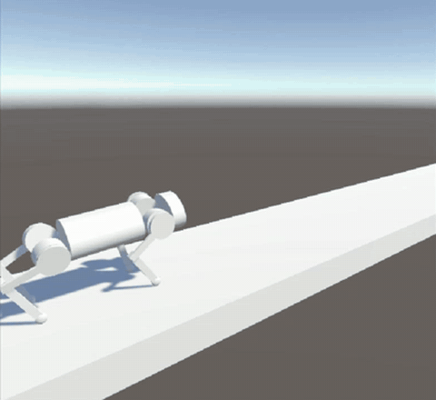
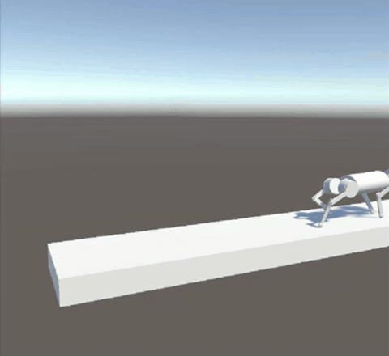
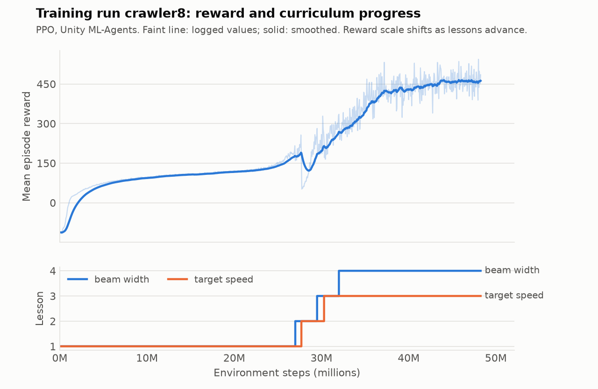

# TO-Bour

A team project to replicate [**Robot Parkour Learning**](https://robot-parkour.github.io) (Zhuang, Fu et al., CoRL 2023)
in Unity ML-Agents: training a legged robot in simulation to run, climb, leap, crawl, and squeeze
through obstacles with reinforcement learning. Built in the **Artificial Intelligence Mentorship (AIM)**
program, Fall 2024.

I owned the locomotion training: the simulated robot, the agent and reward function, and the
training runs.

  
  

Trained policy on the early robot design, October 2024. Cropped from screen recordings of the Unity editor
(<a href="docs/media/tobour-prototype-1.mp4">MP4 1</a>, <a href="docs/media/tobour-prototype-2.mp4">MP4 2</a>).

## Background

The paper trains a separate policy for each parkour skill in simulation, using one simple reward.
It first lets the robot pass through obstacles ("soft" dynamics) and then makes them solid ("hard"
dynamics). It distills the skills into one vision-based policy with DAgger and deploys that policy on
low-cost quadruped robots. Our team divided that pipeline:

| Paper component | Owner |
| --- | --- |
| Simulated robot, skill reward, RL training (running skill) | **Kenny Quach** |
| Obstacle environments for climb, leap, and crawl | Sarah Ibadi |
| Distilling trained policies into a smaller model | Srinivas Vardhan Dintakurthi |
| Physical robot | Zaaim Rahman, Sean Purnell |
| Mentor and group lead | Daniel Nguyen |

## What I built

- **Robot in Unity**: an articulated body of rigid parts with configurable joints, driven by a
  joint-drive controller (spring, damper, and force limit per joint). The policy outputs target joint
  rotations.
- **Reward, following the paper's skill reward**: rewards matching a target forward speed,
  penalizes sideways and vertical velocity, rewards a low yaw rate, charges an energy cost from joint
  torques, and adds an alive bonus and a body-height term. Each term has a tunable weight. Episodes end
  with a penalty if the robot tips past angle limits, drifts to the beam edge, or falls off. Reaching
  the end of the track earns a bonus and drops the target speed to zero, so the policy also has to learn
  to stop.
- **Curriculum training with PPO**: each training area places the robot on a beam. As reward
  crosses each lesson's threshold, the curriculum widens the range of beam widths (from a fixed width
  to 0.4–10 units) and target speeds (from a fixed speed to 0–2).
- **Experiment loop**: 11 training runs over Oct 20–26, 2024, each 19–90M environment steps.
  Between runs I changed the reward weights and the curriculum (table below).
- **The TO-Bour robot (December 2024)**: moved the agent onto the team's Blender-modeled robot
  body. Added a soft/hard dynamics toggle that mirrors the paper's two-stage setup, privileged
  observations of the obstacle ahead (distance, length, height), and an energy cost based on torque ×
  joint velocity, closer to the paper's.

I wrote the agent, controller, and reward code directly on the ML-Agents `Agent` API.

## Training

<picture>
  <source media="(prefers-color-scheme: dark)" srcset="docs/media/training-crawler8-dark.png">
  
</picture>

Run `crawler8` got furthest through its curriculum. After a long plateau, the policy began clearing
reward thresholds about 27M steps in. It reached the final beam-width and target-speed lessons by about
32M steps.

| Run | Steps | Curriculum |
| --- | ---: | --- |
| `crawler` | 30.0M | none |
| `crawler2` | 28.3M | beam width |
| `crawler3` | 18.8M | beam width |
| `crawler4` | 30.0M | beam width |
| `crawler5` | 30.0M | beam width |
| `crawler6` | 30.0M | beam width |
| `crawler7` | 60.1M | beam width, target speed |
| `crawler8` | 48.2M | beam width, target speed |
| `crawler9` | 21.9M | target speed |
| `crawler10` | 60.0M | target speed |
| `crawler11` | 90.0M | target speed |

About 447M environment steps in total, read from the runs' TensorBoard logs with
[`tools/tbread.py`](tools/tbread.py).

**Setup:** Unity 2022.3, ML-Agents (Python package 1.1.0), PyTorch. PPO with a 3×512 network,
LSTM memory, and a small curiosity bonus.

## Code

| Folder | What it is |
| --- | --- |
| [`unity/early-design`](unity/early-design) | October 2024: the early robot on the beam, matching the clips and training runs above. Includes the trained policy from run `crawler11`. |
| [`unity/to-bour`](unity/to-bour) | December 2024: the TO-Bour robot with obstacle courses and the soft/hard dynamics toggle. No trained policy included. |

Each folder is a standalone Unity project. To open one:

1. Install Unity **2022.3.49f1** and Git. The ML-Agents package (`release_22`) installs from GitHub
   when the project first opens.
2. In Unity Hub, choose **Add project from disk** and select the folder.
3. Open `Assets/Scenes/Crawler.unity`.

In `early-design`, one training area has the trained policy attached. Press Play with no trainer
running to watch it walk the beam.

To train, install the ML-Agents Python package (`pip install mlagents==1.1.0`, Python 3.10), then run
`mlagents-learn config/crawler.yaml --run-id=<name>` from the project folder and press Play in Unity.
In `to-bour`, choose the course on the agent component of the robot prefab: set `obstacleType` to
`RUNNING`, `LEAPING`, `CLIMBING`, or `CRAWLING`, and toggle `useSoftDynamics`.

## Credits

- Ziwen Zhuang, Zipeng Fu, et al., [Robot Parkour Learning](https://robot-parkour.github.io), CoRL 2023,
  the paper this project set out to replicate.
- The obstacle-course generation in `unity/to-bour` is Sarah Ibadi's, and the TO-Bour robot model is
  the team's.
- [Unity ML-Agents](https://github.com/Unity-Technologies/ml-agents) (Apache License 2.0).
  `GroundContact.cs` is adapted from its examples; see [`THIRD_PARTY_NOTICES.md`](THIRD_PARTY_NOTICES.md).

## License

MIT; see [`LICENSE`](LICENSE). `GroundContact.cs` remains under the Apache License 2.0.
